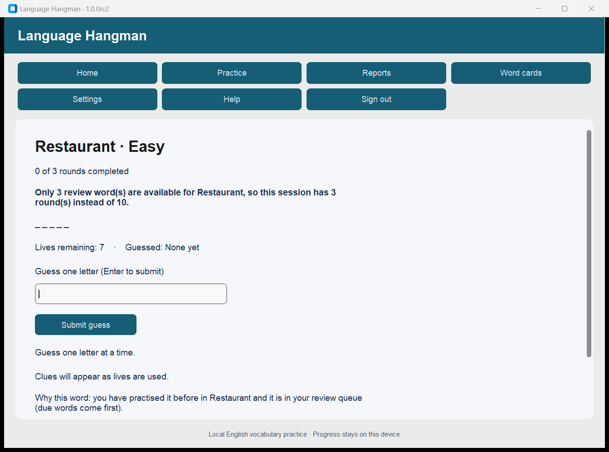

# Language Hangman Desktop

An offline Windows app for practising vocabulary through Hangman: 30 English travel cards for
the Restaurant, Airport and Hotel, plus word lists in English, Spanish, Italian and German at
five levels. It is built with Python, CustomTkinter and SQLite. It is rule-based software built
with AI assistance: it contains no machine learning, chatbot or network service, and it needs
no account or internet connection.

**Status: 1.0.0rc5, a tested release candidate. It is not the final 1.0. Nobody has reviewed
the word lists yet, and the app says so.**

| Verified by automated and scripted checks on the build machine (Windows 11, 125%) | Still pending: needs people or the owner |
| --- | --- |
| 199 automated tests, lint, content and release checks on `1c2eb39` (installer built from `f2bb6b9`, same application code) | Installing on a clean Windows account without Python (G5) |
| Installer built from `f2bb6b9`; install, upgrade from rc4 with its own data, beta import, recovery, uninstall | Keyboard-only use by a person; real 100% and 150% display scaling (G6–G8) |
| 17-step scripted journey in the installed app, without Python on `PATH` | Review of every word by qualified reviewers, one per language (G9) |
| Third-party notices installed and checked against every shipped file | Five learner sessions (G10) |
| Window layout and the game board measured at the minimum size (real 125%, emulated 100% and 150%) | Owner decisions: installer terms, Review rule, supported history, intended learner, who wrote the word sheet |

Automated GUI checks call the app's own handlers and Tk's focus order; they are not a person
using a keyboard. The build machine has had Python and earlier versions installed, so it is
not a clean-machine test. Gates, evidence and the go/no-go record are in
[docs/ACCEPTANCE.md](docs/ACCEPTANCE.md).

## Demo

[2¾-minute captioned recording](docs/media/language-hangman-1.0.0rc5-demo.mp4): a new
profile, Review offered as Standard for a new learner, a Standard session with learning
cards, reports, a shortened Review, resuming after closing, word cards and word lists, a German
board with its extra keys, text size, settings and recovery from a damaged data file. It is a
scripted run of revision `f2bb6b9` from source, driven through the app's own controls and
slowed so that captions can be read; only the app window is captured.

Screenshots from the installed rc5 build:

| Practice round | Review shortened, with the reason | Recovery window |
| --- | --- | --- |
|  |  |  |

## What it does

- Local profiles protected by a password, and guest practice that is not saved.
- 30 English travel cards in three situations, with plain-English meanings, an original
  example, a usage note and an approximate respelling for pronunciation.
- 1,538 words in English, Spanish, Italian and German at five levels, each with three clues
  in English. They come from the owner's older word sheet and **have not been reviewed**.
- Easy (7 lives, clues after wrong guesses 1, 3 and 5) or Hard (5 lives, all clues with 2 lives
  left), 3, 5 or 10 rounds per session.
- A game board: the figure, the word as letter tiles, lives as pips, and a keyboard that
  doubles as the record of what you have tried, with each language's extra letters. Type a
  letter or click a key.
- Sarcastic feedback lines: the owner's originals, restored in rc5.
- **Standard** practice, and **Review** of words you have already practised in that
  situation or level (due words first). A new learner is offered Standard instead, and a
  shortened Review says why.
- Sessions are saved after every guess and can be resumed after closing the app.
- Reports on rounds, sessions, words and guesses; word cards for every word.
- Full backup and restore, a daily automatic backup (seven kept), profile export and
  deletion, and a recovery window if the data file is damaged.
- Text size, keyboard operation and privacy-safe diagnostics.

## Install

1. Download `LanguageHangman-1.0.0rc5-Setup.exe` from the release package and check it:

   ```powershell
   Get-FileHash .\LanguageHangman-1.0.0rc5-Setup.exe -Algorithm SHA256
   ```

   Expected: `a94a92696cf5f001fb7326fb92628557f5907b0122383d3269d3aa4e26d47531`.
2. Run it. **The installer is not code-signed**, so Windows SmartScreen shows "Windows
   protected your PC" and "Unknown publisher". Choose *More info › Run anyway* only if the
   checksum matched. It installs for the current user; no administrator rights are needed.
3. Start *Language Hangman* from the Start menu.

**Upgrade:** close the app and run the newer installer. Profiles, progress and saved
sessions are kept; any database upgrade runs on a copy after a pre-upgrade backup.
**Uninstall:** Settings › Apps, or the Start-menu uninstaller. Your data is kept in
`%LOCALAPPDATA%\LanguageHangman`; delete that folder to remove it.

## Data, backup and recovery

- Data lives in `%LOCALAPPDATA%\LanguageHangman\app.db`; backups in its `backups` folder.
- **Settings › Create full backup** saves every profile. **Restore** checks a backup,
  keeps a safety copy of the current data, and only then replaces it. An invalid backup
  changes nothing. If the switch itself fails, every file is put back; if Windows prevents
  that, the message says exactly which file is where and how to put it back.
- **If the data file is damaged**, the app opens a recovery window instead of failing.
  Choose the newest automatic backup (or your own) and confirm; the damaged file is kept
  in `backups\quarantine-…` and you can sign in again.
- **Moving from the older browser beta:** on the sign-in screen, choose *Restore / import
  old database* and pick the beta's `data\app.db`. This replaces all current profiles after
  confirmation. Old results stay in reports; new practice uses the current words.
- **Diagnostics** (Settings) export the app, Python and Windows versions, database checks
  and recent failure records (operation, stage, error type). They exclude passwords,
  usernames, session content and personal folder paths.

## Performance (build machine)

On an AMD Ryzen 7 6800H laptop with an NVMe SSD, on a fresh profile, a typical guess takes
**40–42 ms** from submission to redrawn screen on travel cards (three runs of 55 samples; rc4
measured 28–51 ms in the same session). The guess that ends a round takes 555–589 ms at the 95th
percentile on travel cards and 709–803 ms in a word list. With one profile holding 5,000+
completed rounds (4.55 MB of data), reports aggregate in 56 ms (20 samples), a full backup takes
95 ms (5 samples), and moving between Home, Reports and Practice setup takes 357–626 ms (5
samples each). Word cards takes 1.9–3.1 s to open, and switching word list takes about 0.15 s.
The installed program shows its window in 1.03–1.04 s, and in 2.06 s the first time it loads the
word lists into a data file. Details and method:
[docs/VERIFICATION.md](docs/VERIFICATION.md#performance-build-machine).

## Known limitations

- **The word lists are unreviewed.** Automated checks cover their structure, not whether a
  word, clue or level is right. Levels are the old sheet's own labels and measure nothing.
- Explanations and clues are in English in every language, not translations. The intended
  learner (reads short, simple English, about CEFR A2) is a proposed profile awaiting the
  owner and a reviewer; the content is not certified for any level.
- Pronunciation is an approximate respelling on travel cards, not audio or IPA. Word-list
  words have no pronunciation, example or usage note.
- Travel cards offer two distinct clues per word (their synonym clue is empty by design);
  word-list words offer three.
- The feedback lines are sarcastic on purpose, and a learner of English may not follow them.
- Windows screen readers generally cannot read CustomTkinter controls.
- The database is not encrypted; passwords protect in-app access only. There is no
  password reset by email. Full backups contain every profile's password hash: keep them
  private.
- One copy of the app per Windows account at a time; guest practice is discarded on
  sign-out.
- The installer is unsigned and shows no licence terms during setup (DEC-14 is open).
  `LICENSE.txt` and the third-party notices are installed next to the program.
- Tested on the Windows 11 build machine only; Windows 10 and other machines are unchecked.
- Supported history (proposed): up to 5 profiles and 5,000 rounds per profile.

## How it was built

The beta and rc1 were written with AI coding assistance. The rc2 to rc5 work (defect fixes,
the interface redesign, the word lists, tests, packaging, validation and these documents) was
carried out by Claude Code at the owner's direction; an independent review of rc2 found the
restore defect fixed in rc3. Every fix was reproduced first and checked afterwards, and results
are tied to commits. Mistakes in the AI's own work are recorded rather than hidden — including
the rc4 redesign that slowed the game, which measurement caught before release, and five rc5
test scenarios that were written but not run until a count exposed them (incidents I-1 to
I-12). Educator, learner and manual checks are left for people to
perform and record. See
[How AI assistance was used and verified](docs/DELIVERY.md#how-ai-assistance-was-used-and-verified).

## Project documents

| Document | Contents |
| --- | --- |
| [ACCEPTANCE.md](docs/ACCEPTANCE.md) | Release gates, manual test procedures, evidence index, go/no-go |
| [DELIVERY.md](docs/DELIVERY.md) | Defect and task register, RAID log, decision log, milestones, AI assistance |
| [VERIFICATION.md](docs/VERIFICATION.md) | Results by revision, installer validation, performance, requirement traceability |
| [ARCHITECTURE.md](docs/ARCHITECTURE.md) | Components, data flow, persistence, recovery |
| [CONTENT_REVIEW.md](docs/CONTENT_REVIEW.md) | Intended learner, review worksheet for 30 cards, provenance and third-party components |
| [USER_ACCEPTANCE.md](docs/USER_ACCEPTANCE.md) | Five-session learner protocol |
| [THIRD-PARTY-NOTICES.txt](packaging/third-party/THIRD-PARTY-NOTICES.txt) | Bundled components, versions and licences |
| [RELEASE_NOTES.md](RELEASE_NOTES.md), [RELEASE_CHECKLIST.md](RELEASE_CHECKLIST.md) | What changed; how to release |
| [LEGACY_BROWSER.md](docs/LEGACY_BROWSER.md) | The unsupported browser prototype |

## For developers

Python 3.12 on Windows:

```powershell
py -3.12 -m venv .venv
.\.venv\Scripts\python.exe -m pip install -r requirements-desktop.txt -r requirements.txt
.\.venv\Scripts\python.exe desktop_app.py
```

(`./scripts/start.ps1` does the same for running the app.) Checks, in this order, on an
untouched checkout (see [the verification sequence](docs/VERIFICATION.md#verification-sequence)):

```powershell
python -m src.cli release-check
python -m ruff check .
python scripts/check_curated_content.py
python -m pytest -rs
python desktop_app.py --smoke-test desktop-evidence
```

The GUI tests and the smoke journey need a Windows desktop session; they use temporary
data, never yours. Build the installer with Python 3.12.1 and Inno Setup 6.7.3:
`./scripts/build_desktop.ps1 -Python <python 3.12.1 exe>`, then follow
[RELEASE_CHECKLIST.md](RELEASE_CHECKLIST.md).

### Code map

| Supported desktop app | Responsibility |
| --- | --- |
| `desktop_app.py` | Entry point: single instance, recovery window, smoke journey |
| `src/desktop/widgets.py` | Design tokens, button weights, responsive text, the drawn game board |
| `src/desktop/` | Views, recovery window, keyboard and window helpers, logging |
| `src/desktop/content/english.json` | The 30 curated words |
| `src/services/practice_service.py` | Session orchestration; saves every action |
| `src/services/game_service.py` | Game rules, Review eligibility, completion |
| `src/services/curated_content.py`, `word_service.py` | Curated-only word selection |
| `src/services/desktop_storage.py` | Backups, restore with rollback, recovery, export, diagnostics |
| `src/db/` | SQLite schema, migrations, transactions |
| `packaging/`, `scripts/build_desktop.ps1` | PyInstaller and Inno Setup build |
| `packaging/third-party/`, `scripts/third_party_notices.py` | Third-party notices and their coverage check |
| `scripts/validation/` | Release validation: window capture, fixtures, measurement, evidence, kit, demo |
| `tests/` | 175 tests, including GUI scenarios run one per process |

**Legacy, unsupported:** `app.py`, `src/ui/`, `src/gateway/`, `frontend/`, `Dockerfile`,
`data/words/` and most of `src/cli.py` belong to the earlier browser prototype. They are not
in the installer; the desktop app reuses the shared engine and can import beta databases.
See [LEGACY_BROWSER.md](docs/LEGACY_BROWSER.md).

## Licence

The software is under the [MIT licence](LICENSE). The 30 teaching cards and the application
icon are **not** covered: their authorship is still being confirmed, so no licence has been
chosen for them yet. Bundled third-party components keep their own licences; see
[THIRD-PARTY-NOTICES.txt](packaging/third-party/THIRD-PARTY-NOTICES.txt).
