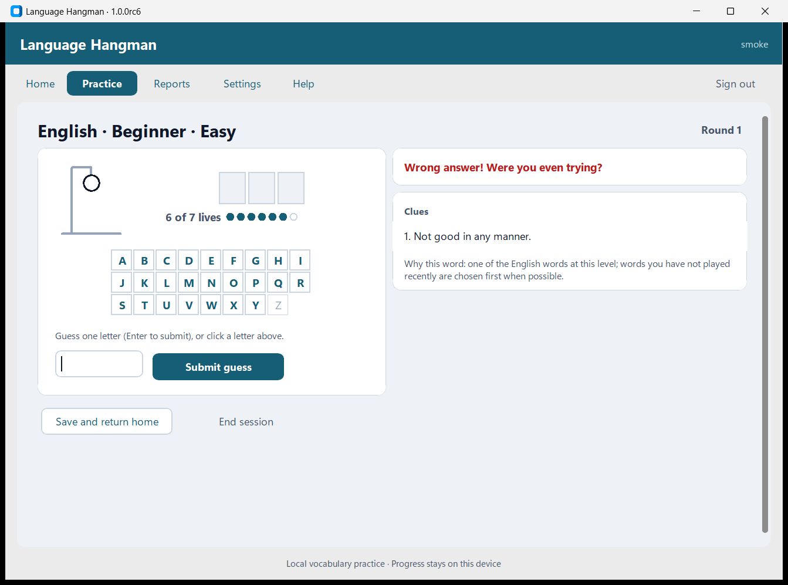
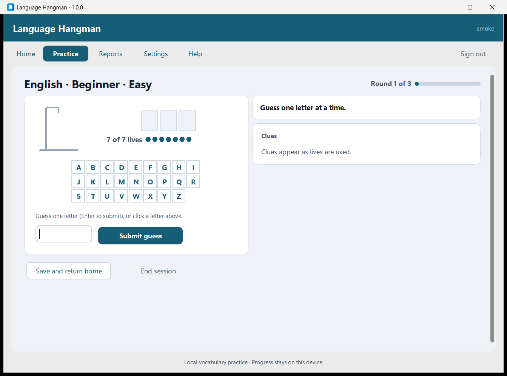
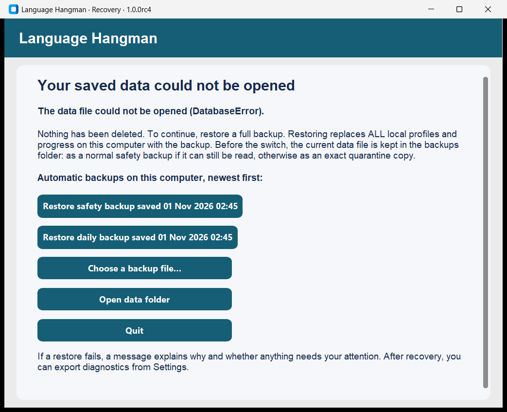

# Language Hangman Desktop

An offline Windows app for practising vocabulary through Hangman: 1,544 words in English,
Spanish, Italian and German at five levels. It is built with Python, CustomTkinter and SQLite.
It is rule-based software built with AI assistance: it contains no machine learning, chatbot or
network service, and it needs no account or internet connection.

**Status: 1.0.0, released on the owner's approval on 2026-11-01.**

| Verified by automated and scripted checks | Reported by the owner on 1.0.0rc8, without a detailed record |
| --- | --- |
| 216 automated tests, lint, content and release checks on `12afdd8`, three times (installer built from `5f89265`, same application code) | Clean install on a separate system (G5) |
| GitHub Actions on Linux and Windows, including the smoke journey on Windows | Keyboard-only use (G6) |
| Installer built from `5f89265`; licence page shown; install, upgrade from rc9 with its own data, beta import, recovery, uninstall | Display at real 100% (G7) |
| 17-step scripted journey in the installed app, without Python on `PATH` | Recovery by hand (G8) |
| Third-party notices installed and checked against every shipped file | |
| Window layout and the game board measured at the minimum size (real 125%, emulated 100% and 150%) | |

Automated GUI checks call the app's own handlers and Tk's focus order; they are not a person
using a keyboard. The installer checks ran on the build machine, which has had Python and
earlier versions installed. Gates, evidence and the go/no-go record are in
[docs/ACCEPTANCE.md](docs/ACCEPTANCE.md).

## Demo

[2½-minute captioned recording](docs/media/language-hangman-1.0.0-demo.mp4): a new
profile, Review my words refused for a new learner, play that runs until you end it, the card
after each word, reports, Review my words, resuming after closing, a plain letter revealing an
accent, text size, settings and recovery from a damaged data file. It is a scripted run of
revision `5f89265` from source, driven through the app's own controls and slowed so that
captions can be read; only the app window is captured.

Screenshots from the installed 1.0.0 build:

| Practice round | Review my words | Recovery window |
| --- | --- | --- |
|  |  |  |

## What it does

- Local profiles protected by a password, and guest practice that is not saved.
- 1,544 words in English, Spanish, Italian and German at five levels, each with three clues
  in English, from the owner's word sheet.
- Easy (7 lives, clues after wrong guesses 1, 3 and 5) or Hard (5 lives, all clues with 2 lives
  left).
- A game board: the figure, the word as letter tiles, lives as pips, and an A–Z keyboard that
  doubles as the record of what you have tried. Type a letter or click a key. Accents count as
  the normal letter: `a` fills in `á`, and `s` fills in `ß`.
- Sarcastic feedback lines: the owner's originals, restored in rc5.
- **All words** keeps going, one word after another, until you choose End session. It favours
  words that need practice, and once you have played them all they repeat, oldest first.
- **Review my words** plays the words you have already completed at that language and level,
  due words first, each once. A new learner is offered All words instead.
- Sessions are saved after every guess and can be resumed after closing the app. End session
  stops at once; Reports counts the session if you finished at least one word.
- Reports on rounds, sessions, words and guesses.
- Full backup and restore, a daily automatic backup (seven kept), profile export and
  deletion, and a recovery window if the data file is damaged.
- Text size, keyboard operation and privacy-safe diagnostics.

## Install

1. Download `LanguageHangman-1.0.0-Setup.exe` from the release package and check it:

   ```powershell
   Get-FileHash .\LanguageHangman-1.0.0-Setup.exe -Algorithm SHA256
   ```

   Expected: `1707bd4a8a3c4f9d3baf2a216b97cdbd5e1acc43caadbea72f816a4ba7fcfa1e`.
2. Run it. **The installer is not code-signed**, so Windows SmartScreen shows "Windows
   protected your PC" and "Unknown publisher". Choose *More info › Run anyway* only if the
   checksum matched. Setup then shows the licence, which you need to accept. It installs for the
   current user; no administrator rights are needed.
3. Start *Language Hangman* from the Start menu.

**Upgrade:** close the app and run the newer installer. Profiles, progress and saved
sessions are kept; any database upgrade runs on a copy after a pre-upgrade backup.
**Uninstall:** Settings › Apps, or the Start-menu uninstaller. Your data is kept in
`%LOCALAPPDATA%\LanguageHangman`; delete that folder to remove it.

## Data, backup and recovery

- Data lives in `%LOCALAPPDATA%\LanguageHangman\app.db`; backups in its `backups` folder.
- **Settings › Create full backup** saves every profile. **Restore** checks a backup,
  keeps a safety copy of the current data, and only then replaces it. An invalid backup
  changes nothing. If the switch itself fails, every file is put back; if Windows prevents
  that, the message says exactly which file is where and how to put it back.
- **If the data file is damaged**, the app opens a recovery window instead of failing.
  Choose the newest automatic backup (or your own) and confirm; the damaged file is kept
  in `backups\quarantine-…` and you can sign in again.
- **Moving from the older browser beta:** on the sign-in screen, choose *Restore / import
  old database* and pick the beta's `data\app.db`. This replaces all current profiles after
  confirmation. Old results stay in reports; new practice uses the current words.
- **Diagnostics** (Settings) export the app, Python and Windows versions, database checks
  and recent failure records (operation, stage, error type). They exclude passwords,
  usernames, session content and personal folder paths.

## Performance (build machine)

On an AMD Ryzen 7 6800H laptop with an NVMe SSD, on a fresh profile, a typical guess takes
**34–48 ms** from submission to redrawn screen across three word lists (three runs of each, with
48–102 samples a run; rc9 measured 34–52 ms in the same session). The guess that ends a round
takes 516–726 ms at the 95th percentile (rc9: 535–691 ms). In one 200-round session, the last 20
rounds were no slower than the first 20. With one profile holding 5,000+ completed rounds (5.54
MB of data), reports aggregate in 81 ms, a full backup takes 167 ms, and moving between Home,
Reports and Practice setup takes 554–851 ms, in a session when the machine ran slower than usual.
The installed program shows its window in 0.93–1.15 s, and in 2.28 s the first time it loads the
words into a data file. Details and method:
[docs/VERIFICATION.md](docs/VERIFICATION.md#performance-build-machine).

## Known limitations

- Automated checks cover the words' structure, not whether a word, clue or level is right.
  Levels are the old sheet's own labels and measure nothing.
- Clues are in English in every language, not translations, so the app suits someone who reads
  English, and the content is not certified for any level.
- Words have no pronunciation, example or usage note, and none were invented.
- Accents are not practised: a plain letter fills them in, so the game does not test where
  they go (owner decision DEC-28).
- The feedback lines are sarcastic on purpose, and a learner of English may not follow them.
- Windows screen readers generally cannot read CustomTkinter controls.
- The database is not encrypted; passwords protect in-app access only. There is no
  password reset by email. Full backups contain every profile's password hash: keep them
  private.
- One copy of the app per Windows account at a time; guest practice is discarded on
  sign-out.
- The installer is unsigned. Setup shows `LICENSE`, and `LICENSE.txt` and the third-party notices
  are installed next to the program. Whether that page fully meets the Microsoft terms in
  Python's licence is a legal question nobody has reviewed (RK-7).
- Display scaling: real 100% was reported by the owner, real 125% is automated on the build
  machine, and 150% is emulated only. Windows 10 is unchecked.
- Supported history: up to 5 profiles and 5,000 rounds per profile, the largest size measured.

## How it was built

The beta and rc1 were written with AI coding assistance. The rc2 to 1.0.0 work (defect fixes,
the interface redesign, the word lists, tests, packaging, validation and these documents) was
carried out by Claude Code at the owner's direction; an independent review of rc2 found the
restore defect fixed in rc3. Every fix was reproduced first and checked afterwards, and results
are tied to commits. Mistakes in the AI's own work are recorded rather than hidden — including
the rc4 redesign that slowed the game, which measurement caught before release, five rc5 test
scenarios that were written but not run until a count exposed them, and an rc5 layout defect
that moved the letter keys, which a test caught in rc6 (D-33, incidents I-1 to I-14). Manual checks are
left for people to perform. See
[How AI assistance was used and verified](docs/DELIVERY.md#how-ai-assistance-was-used-and-verified).

## Project documents

| Document | Contents |
| --- | --- |
| [ACCEPTANCE.md](docs/ACCEPTANCE.md) | Release gates, manual test procedures, evidence index, go/no-go |
| [DELIVERY.md](docs/DELIVERY.md) | Defect and task register, RAID log, decision log, milestones, AI assistance |
| [VERIFICATION.md](docs/VERIFICATION.md) | Results by revision, installer validation, performance, requirement traceability |
| [ARCHITECTURE.md](docs/ARCHITECTURE.md) | Components, data flow, persistence, recovery |
| [PROVENANCE.md](docs/PROVENANCE.md) | Where the content came from, and third-party components |
| [THIRD-PARTY-NOTICES.txt](packaging/third-party/THIRD-PARTY-NOTICES.txt) | Bundled components, versions and licences |
| [RELEASE_NOTES.md](RELEASE_NOTES.md), [RELEASE_CHECKLIST.md](RELEASE_CHECKLIST.md) | What changed; how to release |
| [LEGACY_BROWSER.md](docs/LEGACY_BROWSER.md) | The unsupported browser prototype |

## For developers

Python 3.12 on Windows:

```powershell
py -3.12 -m venv .venv
.\.venv\Scripts\python.exe -m pip install -r requirements-desktop.txt -r requirements.txt
.\.venv\Scripts\python.exe desktop_app.py
```

(`./scripts/start.ps1` does the same for running the app.) Checks, in this order, on an
untouched checkout (see [the verification sequence](docs/VERIFICATION.md#verification-sequence)):

```powershell
python -m src.cli release-check
python -m ruff check .
python scripts/check_curated_content.py
python -m pytest -rs
python desktop_app.py --smoke-test desktop-evidence
```

The GUI tests and the smoke journey need a Windows desktop session; they use temporary
data, never yours. Build the installer with Python 3.12.1 and Inno Setup 6.7.3:
`./scripts/build_desktop.ps1 -Python <python 3.12.1 exe>`, then follow
[RELEASE_CHECKLIST.md](RELEASE_CHECKLIST.md).

### Code map

| Supported desktop app | Responsibility |
| --- | --- |
| `desktop_app.py` | Entry point: single instance, recovery window, smoke journey |
| `src/desktop/widgets.py` | Design tokens, button weights, responsive text, the drawn game board |
| `src/desktop/` | Views, recovery window, keyboard and window helpers, logging |
| `src/desktop/content/levels/` | The 1,544 words, one file per language |
| `src/services/practice_service.py` | Session orchestration; saves every action |
| `src/services/game_service.py` | Game rules, Review eligibility, completion |
| `src/services/curated_content.py`, `word_service.py` | Word selection, from the word lists only |
| `src/services/desktop_storage.py` | Backups, restore with rollback, recovery, export, diagnostics |
| `src/db/` | SQLite schema, migrations, transactions |
| `packaging/`, `scripts/build_desktop.ps1` | PyInstaller and Inno Setup build |
| `packaging/third-party/`, `scripts/third_party_notices.py` | Third-party notices and their coverage check |
| `scripts/validation/` | Release validation: window capture, fixtures, measurement, evidence, kit, demo |
| `tests/` | 216 tests, including GUI scenarios run one per process |

**Legacy, unsupported:** `app.py`, `src/ui/`, `src/gateway/`, `frontend/`, `Dockerfile`,
`data/words/` and most of `src/cli.py` belong to the earlier browser prototype. They are not
in the installer; the desktop app reuses the shared engine and can import beta databases.
See [LEGACY_BROWSER.md](docs/LEGACY_BROWSER.md).

## Licence

The software, the word lists and the application icon are under the [MIT licence](LICENSE). The
legacy word banks in `data/words/` are not covered and are not in the installer. Bundled
third-party components keep their own licences; see
[THIRD-PARTY-NOTICES.txt](packaging/third-party/THIRD-PARTY-NOTICES.txt).
