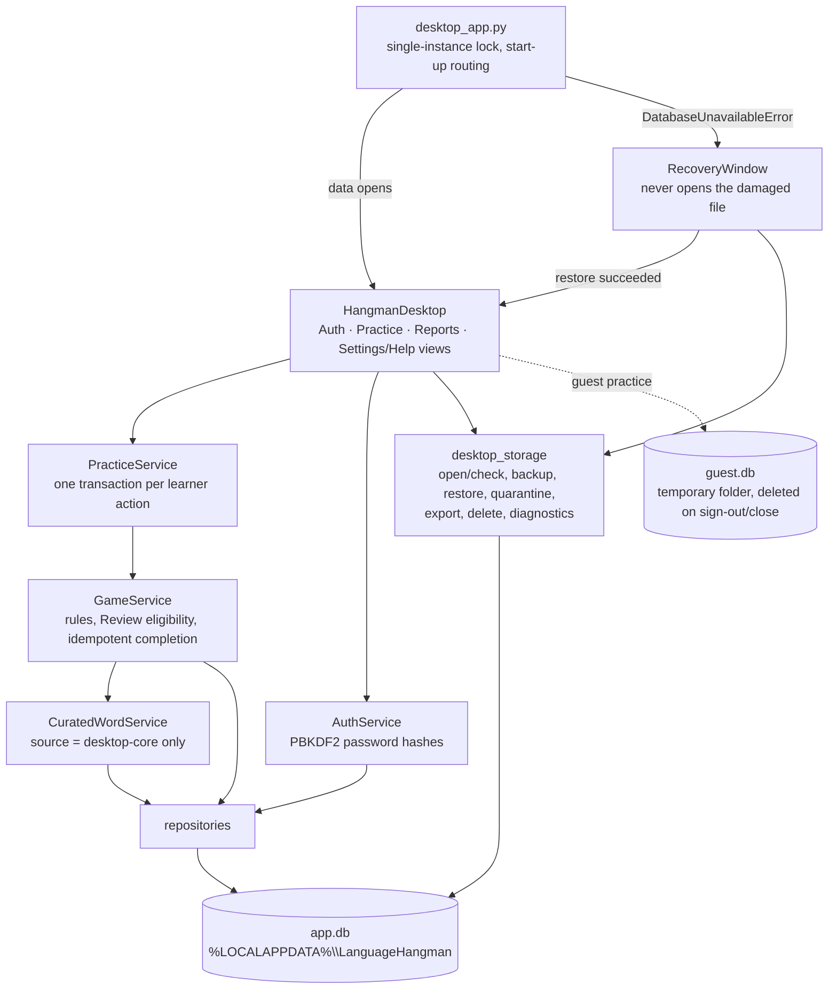
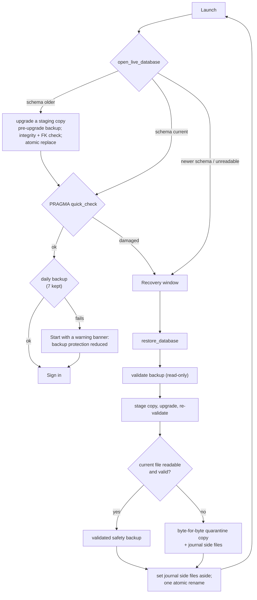

# Desktop architecture

The supported product is one native Windows process: CustomTkinter for the interface and
SQLite for storage. It starts no server, opens no network connection and uses no
authentication cookie. The older browser prototype is legacy and is not described here
(see [LEGACY_BROWSER.md](LEGACY_BROWSER.md)).

## Components



## One learner action, one transaction

Every guess, round start, next round and discard is a single SQLite transaction
(`BEGIN IMMEDIATE`). Repository calls inside it share one connection
(`src/db/transaction.py`), so nothing commits part-way.

```mermaid
sequenceDiagram
    participant UI as Practice view
    participant P as PracticeService
    participant G as GameService
    participant D as SQLite
    UI->>P: guess(letter, round_key)
    P->>D: BEGIN IMMEDIATE; read saved session snapshot
    P->>P: reject if round_key is stale
    P->>G: record_guess
    alt round finished
        G->>D: receipt exists? (round UUID)
        G->>D: round result, word progress, review queue, session totals, receipt
    end
    P->>D: write new snapshot (guesses, clues, learning card, next round)
    P->>D: COMMIT (any error: ROLLBACK, nothing saved)
    UI->>P: reload persisted state and redraw
```

Each round has a stable UUID and a unique completion receipt, so a retried completion
returns the recorded outcome without counting twice. Saved sessions are versioned JSON
(`schema: 1`), so closing the app at any moment resumes the same word, guesses, clues and
learning card. Optional keys added later (such as `notice`) keep older snapshots loadable.

## Practice rules

- **Curated corpus only.** `CuratedWordService` sets `source = "desktop-core"`, applied
  where rows are fetched for listing, counting, strict selection and every fallback.
  Legacy words, results and review items stay in the database for history and reports.
- **Candidate lists.** `None` means no restriction; an empty list means no eligible words.
- **Review eligibility.** A word is eligible when the learner has an active review-queue
  item for it (created when a round with it is completed) and it is a curated word in the
  chosen situation. Due items come first, then items not yet due; each word appears once per
  session. With none, `NoReviewWordsError` is raised and the app offers Standard practice.
  A shorter session, or one that runs out mid-way, says why.
- **Words shared with the legacy bank.** bread, slowly, early, quiet and clean exist in
  both banks. When curated content is seeded, their shared rows take the curated content,
  so earlier practice of those words counts as practised.

## Start-up, upgrade and recovery



Any failure before the rename raises `RestoreError` with a stage (`stage`, `protect`,
`replace`) and leaves the live file byte-for-byte unchanged. Journal side files are set
aside because SQLite would otherwise replay an old journal into the restored database; each
move is recorded as soon as it succeeds, so if a later move or the rename fails, every file
already moved is put back. If a file cannot be put back, the stage is `rollback` and the
message names where each file is kept, where it belongs and where the safety copy is; it
never claims the data is unchanged (D-30).

## Guest and profile separation

A guest gets a separate database in a temporary folder, deleted on sign-out or close.
Guest practice never touches `app.db`; backup, export and deletion are profile-only.

## Diagnostics and privacy

Failures are logged as one fixed-format line: operation code, stage, error type and
version (`op=ui.submit_guess stage=finalize_round error=OperationalError version=…`).
Codes come from the program, never from user input. The diagnostics export adds build and
database-health fields and only log lines matching that exact format, so names, passwords,
words, saved sessions and paths cannot be exported. The database is not encrypted; local
passwords protect in-app access, not the files.

## Windows integration

- Data: `%LOCALAPPDATA%\LanguageHangman`; program: `%LOCALAPPDATA%\Programs\LanguageHangman`
  (per-user install, no administrator rights). Upgrades and uninstall keep the data.
- Windows open inside the screen work area at any display scaling; supported minimum
  800 × 600 logical pixels (fits 1080p at 150%); the recovery window's minimum is 640 × 480.
- Body text wraps to the width each label actually gets (`wrap_to_width`), so a smaller
  window, Large text or higher scaling never clips it (D-31). The recovery window uses the
  saved text size.
- Keyboard: Tab order through buttons, entries and dropdowns; amber focus indication;
  focused controls scroll into view; Up/Down change dropdowns; Enter/Space activate.
- Two CustomTkinter 5.2.2 defects are worked around in `src/desktop/runtime.py` and
  `src/desktop/widgets.py`: destroyed dropdowns stayed registered for rescaling, and
  destroyed windows left timers pending. Dropdowns were also mouse-only.

## Round screen

The figure, word, lives and A–Z keys are drawn on one canvas (`GameBoard`), because building
them from CustomTkinter widgets made every guess slow (D-32). A guess that continues a round
redraws the board in place; a guess that ends a round rebuilds the screen. Canvas content is
not exposed as separate controls, and the keys are not in the Tab order: the guess box and
Submit button are the keyboard route.

## Boundaries

The installer bundles only the desktop import graph, CustomTkinter resources and the
curated content (`packaging/hangman.spec` excludes Streamlit, FastAPI and test tools), plus
`THIRD-PARTY-NOTICES.txt` and `licenses/` from `packaging/third-party/`. The build runs
`scripts/third_party_notices.py check`, which fails if any shipped file is missing from the
notices inventory or the build environment's versions differ from it.
Legacy services remain because the desktop reuses the game engine; new desktop features
should go through `PracticeService` rather than calling completion or snapshot code directly.
